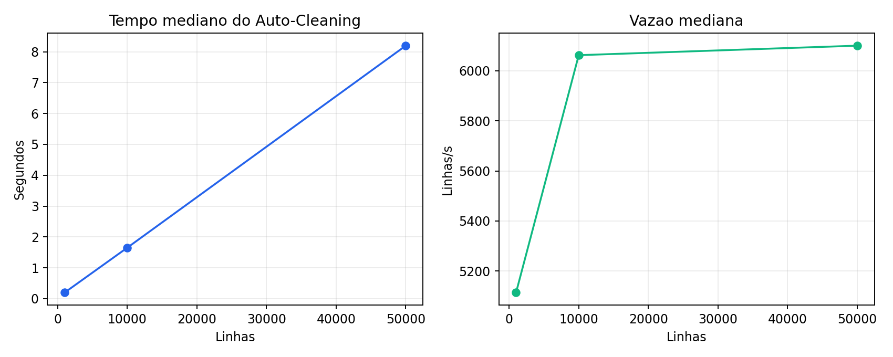
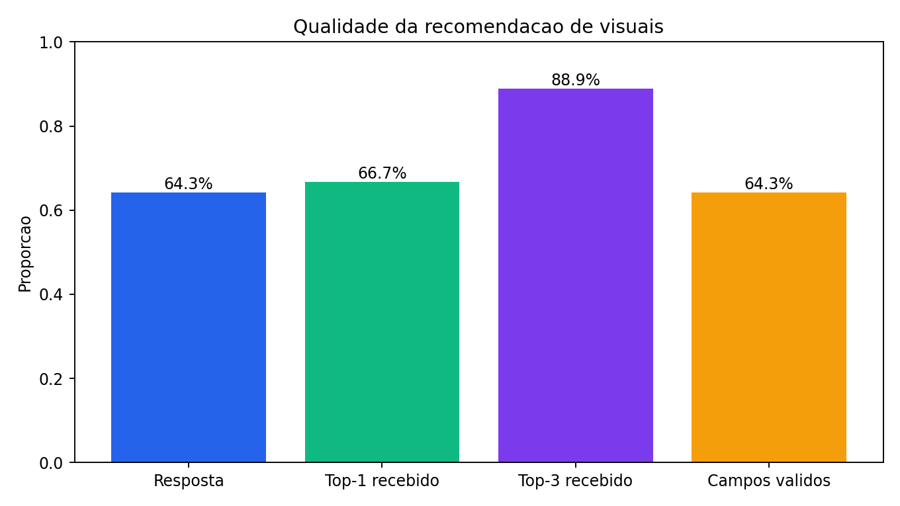
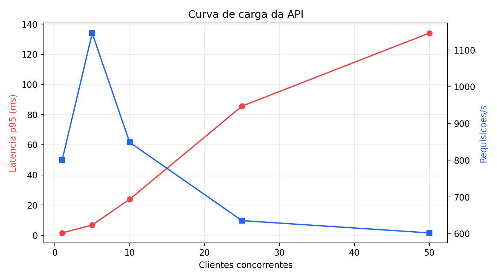
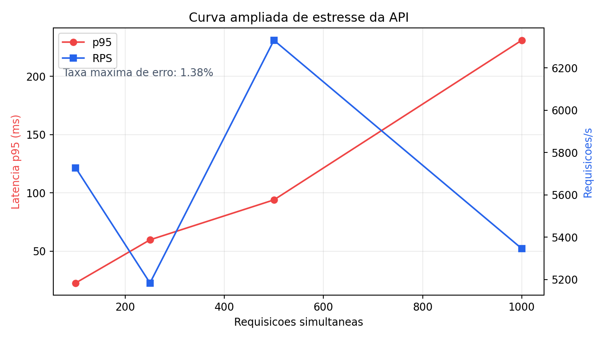

# Relatorio de Validacao do Flash Dash

Gerado em: 2026-11-06T15:06:38.643012+00:00

## Resumo executivo

Este relatorio reune evidencias automatizadas do Auto-Cleaning, modelo estrela, responsividade, desempenho, escalabilidade, seguranca e recomendacao por LLM. Resultados de usabilidade permanecem pendentes ate a coleta com participantes reais.

## Ambiente

- Commit: `b025fb7`
- Sistema: Windows-11-10.0.26200-SP0
- Python: 3.12.8
- CPU logica: 8
- Memoria RAM: 15.74 GB

## Testes funcionais e responsividade

- Backend: passed
- Flutter: passed
- Assercoes cobrem importacao, limpeza, anonimização, esquema estrela, autenticacao, isolamento e validacao da resposta da IA.
- A matriz Flutter verifica viewports de celular, tablet e desktop; navegadores reais ainda devem ser registrados na rodada final.

## Modelagem dimensional (H2)

- Casos rotulados: 8
- Acuracia estrutural: 100.0%
- Precisao dos relacionamentos: 100.0%
- Revocacao dos relacionamentos: 100.0%
- Criterio de pelo menos 90%: **aprovado**.
- O conjunto inclui relacoes 1:1, 1:N, N:N, tres fontes, chaves numericas/textuais, integridade parcial e casos negativos.

## Auto-Cleaning e desempenho

| Linhas | Execucoes | Sucesso | Mediana | p95 | Vazao mediana | Pico de memoria |
|---:|---:|---:|---:|---:|---:|---:|
| 1000 | 3 | 100.0% | 195.5 ms | 200.4 ms | 5114 linhas/s | 86.8 MB |
| 10000 | 3 | 100.0% | 1649.6 ms | 1654.1 ms | 6062 linhas/s | 100.3 MB |
| 50000 | 3 | 100.0% | 8196.8 ms | 8471.1 ms | 6100 linhas/s | 165.6 MB |

## Recomendacao por LLM

- Modelo: `gemini-2.5-flash`
- Casos/repeticoes: 14 / 1
- Taxa de resposta: 64.3%
- Falhas por cota: 35.7%
- Top-1 ponta a ponta: 42.9%
- Top-3 ponta a ponta: 57.1%
- Top-1 entre respostas recebidas: 66.7%
- Top-3 entre respostas recebidas: 88.9%
- Catalogo valido: 64.3%
- Campos validos: 64.3%
- Latencia media: 9209.7 ms

ROC e Precision-Recall nao sao as metricas principais deste modulo: o Flash Dash executa uma recomendacao Top-k multiclasse, nao uma classificacao binaria com limiar. Top-1, Top-3, validade e latencia representam diretamente o objetivo do sistema.

## Escalabilidade

| Concorrencia | RPS | p50 | p95 | p99 | Erros |
|---:|---:|---:|---:|---:|---:|
| 1 | 801.5 | 1.2 ms | 1.6 ms | 1.7 ms | 0 |
| 5 | 1145.9 | 3.6 ms | 6.8 ms | 11.0 ms | 0 |
| 10 | 848.6 | 9.2 ms | 23.9 ms | 34.5 ms | 0 |
| 25 | 635.7 | 26.9 ms | 85.6 ms | 135.1 ms | 0 |
| 50 | 602.4 | 60.1 ms | 134.0 ms | 151.3 ms | 0 |

### Estresse ampliado

| Concorrencia | RPS | p50 | p95 | p99 | Erro | CPU pico | RAM pico |
|---:|---:|---:|---:|---:|---:|---:|---:|
| 100 | 5728.1 | 11.1 ms | 22.7 ms | 32.3 ms | 0.00% | 48.44% | 768.68 MB |
| 250 | 5184.1 | 29.3 ms | 59.7 ms | 70.9 ms | 0.00% | 50.0% | 773.66 MB |
| 500 | 6330.3 | 61.5 ms | 94.0 ms | 119.4 ms | 0.00% | 48.51% | 785.34 MB |
| 1000 | 5346.5 | 124.0 ms | 230.9 ms | 329.3 ms | 1.38% | 46.88% | 799.61 MB |

- Repeticoes por nivel: 3; cinco mil requisicoes em cada repeticao.
- Criterio provisorio em 500 simultaneas: **aprovado**.
- Este ensaio representa requisicoes HTTP simultaneas contra `/health`, nao sessoes completas de usuarios.

## Seguranca

- Testes de autenticacao/isolamento: passed
- Bandit: completed - {'LOW': 0, 'MEDIUM': 0, 'HIGH': 0}
- Auditoria de dependencias: completed - 0 achados
- MTTR: pendente (n=0)

## Usabilidade e UX

Coleta pendente. Use os arquivos de `templates/` com 8 a 12 participantes; o analisador calcula conclusao, tempo, erros, SUS, CSAT e mapas de calor sem dados simulados.

## Conclusao provisoria

Os resultados automatizados permitem avaliar a implementacao atual, mas a conclusao cientifica final exige: tres repeticoes da LLM, execucao de carga no ambiente congelado, navegadores/aparelhos reais e coleta de usabilidade. Os criterios foram definidos antes da coleta e devem permanecer inalterados na rodada definitiva.

## Arquivos de evidencia

- `Apresentacao_Validacao_Flash_Dash.pptx`
- `Apresentacao_Validacao_Flash_Dash_Final.pptx`
- `Apresentacao_Validacao_Flash_Dash_Final_v2.pptx`
- `Apresentacao_Validacao_Flash_Dash_Final_v3.pptx`
- `Plano_e_Resultados_Validacao_Flash_Dash.docx`
- `Roteiro_de_Apresentacao_Flash_Dash.md`
- `backend_tests.txt`
- `backend_tests.xml`
- `docx_accessibility.json`
- `environment.json`
- `etl_benchmark.csv`
- `etl_benchmark_log.txt`
- `etl_benchmark_summary.json`
- `etl_performance.png`
- `execution_summary.json`
- `flutter_tests.txt`
- `llm_accuracy.png`
- `llm_evaluation.csv`
- `llm_evaluation.json`
- `llm_log.txt`
- `load_curve.png`
- `load_log.txt`
- `load_test.csv`
- `load_test.json`
- `modeling_evaluation.csv`
- `modeling_evaluation.json`
- `report_log.txt`
- `security_auth_tests.txt`
- `security_bandit.txt`
- `security_bandit_raw.json`
- `security_log.txt`
- `security_pip_audit.txt`
- `security_summary.json`
- `stress_curve.png`
- `stress_test.csv`
- `stress_test.json`
- `stress_test_raw.csv`
- `usability_log.txt`
- `usability_metrics.json`
